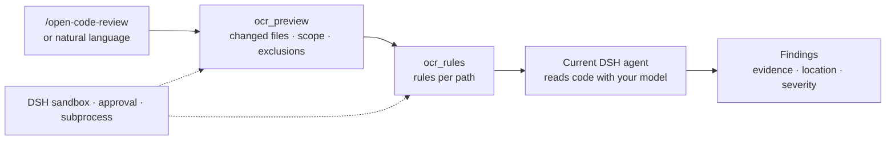

<div align="center">

# Open Code Review for DeepSeek Harness

**Review code with the model you are already talking to.**
Alibaba Open Code Review selects the changed files and resolves the rules — your DSH agent reads the code and reports the findings. No extra API key, no second model setup.

[](https://www.npmjs.com/package/dsh-open-code-review)
[](https://github.com/mocilukalbj/dsh-open-code-review/releases)
[](https://github.com/mocilukalbj/dsh-open-code-review/actions)
[](LICENSE)
[](#compatibility)
[](#requirements)

English · **[简体中文](README.zh.md)**

```sh
dsh plugin --profile web add dsh-open-code-review@0.1.2 --save-exact --ignore-scripts
```

</div>

> **Community adapter**, not an Alibaba or DeepSeek official plugin. In the default
> mode your DSH session model performs the review. OCR's independent reviewer model
> is available as an opt-in mode; delegation does not run OCR's full agent,
> positioning or reflection pipeline.

## Why this plugin?

Code review is where an agent most needs evidence rather than vibes. A plain
"review my diff" prompt often guesses which files changed, forgets the project's
review rules, and can even report a clean result it never computed.

This plugin splits the job:

- **Deterministic work goes to [Alibaba Open Code Review](https://github.com/alibaba/open-code-review)** (`ocr`). It computes the changed-file set for a workspace, a branch range, or a single commit, applies exclusions, and resolves the rules that apply to each path. No model call.
- **The review stays in DSH.** The current agent reads the selected code and writes the findings with the session's model. No second key, and in the default mode the only model that sees the code is the one already serving your DSH session.
- **Execution goes through the host.** Native tools, the DSH sandbox, approval, cancellation, and process lifecycle — not an unmanaged shell command.

Need OCR's own reviewer model? Enable the optional managed mode; it sends code to
the endpoint you configure in OCR.

## What you get

- ✅ **No extra API key** — the default mode reuses your DSH session model.
- ✅ **Deterministic scope** — uncommitted changes, `from..to` branch ranges, or one commit; rule requests accept 1–200 paths.
- ✅ **Project rules, respected** — OCR resolves `rule.json` per path instead of guessing from a prompt.
- ✅ **Native tools and a skill** — `ocr_preview`, `ocr_rules`, and `/open-code-review`.
- ✅ **Sandboxed by design** — DSH managed subprocess; wider access only through per-call approval; any refusal fails closed.
- ✅ **Clean lifecycle** — cancellation, timeout, and plugin unload stop and join the owned process range.
- ✅ **Pinned and offline-safe** — OCR 1.12.10 ships with the plugin; no download or update check at review time.
- ✅ **Four verified hosts** — DSH 0.1.7-rc.2 through 0.2.1-rc.2, exercised by an integration suite that loads real DSH services.

## How it works



OCR supplies deterministic file selection and rule resolution. The agent performs
the review, and large changes should be reviewed in bounded batches with a
coverage checklist so nothing is silently skipped.

## Quick start

**1. Install** into the profile you actually run:

```sh
dsh plugin --profile web add dsh-open-code-review@0.1.2 --save-exact --ignore-scripts
```

The matching GitHub Release tarball is an alternative:

```sh
dsh plugin --profile web add https://github.com/mocilukalbj/dsh-open-code-review/releases/latest/download/dsh-open-code-review.tgz --ignore-scripts
```

For a local checkout:

```sh
dsh plugin --profile web add /absolute/path/dsh-open-code-review --ignore-scripts
```

**2. Enable and reload.** Enable the `dsh-open-code-review` bundle in your host's
plugin manager if it is not already active, then reload/restart as prompted.
Start a new conversation if the current preset has not refreshed its tool and
skill catalog.

**3. Review.**

```text
/open-code-review Review my uncommitted changes. Focus on correctness and security.
```

Or just ask in natural language: "review the current branch against `main`" or
"review commit `abc1234`". Review-only requests do not modify files; the agent
edits only when you explicitly ask it to review **and fix**.

Direct installation does not depend on the community catalog. Marketplace
submission details are in [marketplace/README.md](marketplace/README.md).

## Requirements

- **DSH**: one of the verified kernels in the [compatibility table](#compatibility). Other versions require verification.
- **Node.js 22+**, Git 2.41+, and a local Git workspace.
- **Standard DSH services**: `tools`, `skills`, `subprocess`, `sandboxPolicy`, `sandbox`. The shipped base/web profiles include them; custom compositions also need the skill consumer (`@deepseek-ai/dsh-tool-skill`) to advertise and invoke the skill.
- **OCR is bundled**: `@alibaba-group/open-code-review@1.12.10` is pinned. Its optional native packages cover Linux, macOS and Windows on x64/arm64. Keep optional dependencies enabled. Upstream ships a `postinstall` script, but this adapter invokes the native binary directly and does not need it — install with `--ignore-scripts`. No package is downloaded or updated during a review.

## Usage

| Scope | How to ask |
| --- | --- |
| Uncommitted workspace changes | `/open-code-review` or "review my current changes" |
| Branch range | "review `feature/x` against `main`" |
| One commit | "review commit `abc1234`" |
| Explicit rules | pass an OCR `rule` file, or rely on the repository's `.opencodereview/rule.json` |
| Review and fix | "review and fix the findings" — only then the agent edits code |

`repo` defaults to the **calling session's workspace**, not the harness process
directory. Agentless callers must supply an absolute repository path. Range uses
`from` plus `to` (default `HEAD`); `commit` is mutually exclusive with `from`/`to`.

Outputs keep the upstream JSON fields rather than flattening findings into a
guessed schema. Delegation requires `schema_version: "1"`. Invalid JSON, nonzero
exits, cancelled calls and truncated output are errors — never a "clean review"
result.

## Tools and modes

| Tool | Default | Function |
| --- | --- | --- |
| `ocr_preview` | Enabled | Workspace/range/commit file selection, exclusions, and scope metadata. No model call. |
| `ocr_rules` | Enabled | Rules for 1–200 paths, grouped by content. No model call. |
| `ocr_review` | Opt-in | Full independent OCR review using OCR's separately configured model. |
| `ocr_llm_test` | Opt-in | Check connectivity to that separately configured model endpoint. |

The default mode exposes only the two deterministic tools and the review skill.
Managed mode adds the other two and is off unless `enableManagedReview: true`.

## Compatibility

| DSH kernel | Status |
| --- | --- |
| `0.1.7-rc.2` | ✅ Verified — cross-platform CI and local integration tests |
| `0.2.0-rc.2` | ✅ Verified — cross-platform CI and local integration tests |
| `0.2.1-rc.1` | ✅ Verified — local Linux integration tests; CI matrix covers macOS/Windows |
| `0.2.1-rc.2` | ✅ Verified — local Linux integration tests; CI matrix covers macOS/Windows |
| anything else | Not claimed. Check `engines.dsh`; DSH may refuse to load the bundle. |

Plugin **0.1.2** added admission for the 0.2.1 kernels. See
[UPGRADE.zh.md](UPGRADE.zh.md) for the per-version API notes and
[VALIDATION.md](VALIDATION.md) for exactly what has run and its limits.

## Security and execution model

All OCR invocations go through DSH's managed subprocess service and the resolved
per-session file sandbox:

- **Fail closed.** A missing sandbox, rejected escalation, or unavailable approval channel is an error, never an unconfined fallback.
- **Per-call escalation.** Supplying `sandbox_permissions` requires a matching `justification` and routes through the host approval channel.
- **Owned processes.** Cancellation, timeout and plugin unload terminate and join the subprocess range, including descendants.
- **No ambient secrets.** DSH credential-shaped environment variables are scrubbed; `forwardEnv` lists explicit names only, never values. Diagnostics redact credential shapes.
- **No hidden updater.** The native OCR binary is invoked directly, so the npm launcher's background update checks never start.
- **Local execution.** This is a local DSH plugin; deploying the binary to a remote container is out of scope.

## Configuration

Override the row in your **profile's** `cordis.patch.yml` (or use the generated
plugin config form where the host supports it):

```yaml
- id: open-code-review
  config:
    enableManagedReview: false
    delegateTimeoutMs: 60000
    reviewTimeoutMs: 900000
    maxOutputBytes: 8388608
    ocrPath: ''
    forwardEnv: []
```

| Setting | Purpose |
| --- | --- |
| `enableManagedReview` | Expose `ocr_review` and `ocr_llm_test`. Default `false`. |
| `ocrPath` | Optional absolute path to a **native OCR executable** — not a shell command, JS launcher, or `.cmd` shim. Empty uses the pinned bundled binary. Custom binaries must support delegation JSON schema 1. |
| `delegateTimeoutMs` | Deterministic command timeout, 1,000–300,000 ms. Default 60,000. |
| `reviewTimeoutMs` | Managed review timeout, 1,000–3,600,000 ms. Default 900,000. |
| `maxOutputBytes` | Output cap, 4 KiB–64 MiB. Default 8 MiB; exceeding it fails explicitly. |
| `forwardEnv` | Opt-in **names** of environment variables forwarded to OCR, e.g. `[DEEPSEEK_API_KEY]`. Never put values here. |

Managed mode needs OCR configured through the upstream CLI (same version
recommended) before `enableManagedReview` is flipped. The plugin uses the
existing `~/.opencodereview/config.json`, does not copy DSH credentials, and
does not overwrite OCR configuration. That mode sends code to the OCR endpoint
and persists OCR session state, so it may need a per-call file-sandbox
escalation. Delegation needs none of that setup.

## FAQ

**Does the default mode send my code to Alibaba?**
No. In the default mode OCR runs locally for file selection and rules; the code
is reviewed by the DSH model already driving your session. Managed mode is the
opt-in path that contacts an OCR-configured endpoint.

**Do I need a separate API key?**
No in the default mode. Managed mode uses whatever model you configure in OCR.

**Why are the tools named `ocr_*`?**
Upstream Open Code Review abbreviates to `ocr`; the names keep that vocabulary.

**Windows, macOS, Linux?**
Supported through OCR's optional native packages and verified in CI on all three.

**Can it review a huge PR?**
Yes, but review it in bounded batches with a coverage checklist. The default
output cap is 8 MiB; exceeding it is an explicit error rather than a partial
"clean" result.

**What if my sandbox blocks the review?**
Fix the cause or request a wider `sandbox_permissions` with a `justification`
through the normal approval flow. The plugin never bypasses the sandbox.

## Update and remove

```sh
dsh plugin --profile web add dsh-open-code-review@<version> --save-exact --ignore-scripts
dsh plugin --profile web remove dsh-open-code-review
```

dsh-market can detect newer npm releases; applying them follows the host's
package-script policy. Updating this adapter also updates its pinned OCR
dependency; a separately installed global OCR is unaffected. Disabling or
unloading unregisters the tools and skill but does not delete your OCR config or
review history. Migration, rollback and release details are in
[UPGRADE.zh.md](UPGRADE.zh.md).

## Develop and verify

```sh
npm ci --ignore-scripts
npm run check
npm test
npm run test:integration
npm pack --ignore-scripts
```

The integration suite loads the real DSH services and this bundle through Cordis
Loader, then runs the packaged OCR binary in a temporary Git repository under the
real DSH sandbox. A missing platform sandbox fails the test instead of silently
bypassing confinement. No model credentials are needed. Model review quality and
live API providers are outside these deterministic tests.

The package ships JavaScript directly, so source installs need no `prepare`
build. Native OCR comes from Alibaba's optional platform packages; keep them
enabled while blocking lifecycle scripts with `--ignore-scripts`.

## Attribution

Apache-2.0. See [NOTICE](NOTICE). The review workflow is adapted from Alibaba's
Open Code Review delegation skill; the OCR implementation is consumed from its
original npm package. Upstream references:
[delegation documentation](https://github.com/alibaba/open-code-review/blob/main/pages/src/content/docs/en/integrations/delegate.md) ·
[DSH bundle documentation](https://github.com/deepseek-ai/deepseek-harness/blob/master/docs/user/develop/basic/publish.md).

---

If this plugin makes your reviews more evidence-driven, a ⭐ helps the next
person find it.
