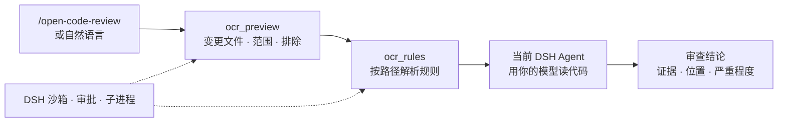

<div align="center">

# Open Code Review for DeepSeek Harness

**用你正在对话的模型审查代码。**
阿里 Open Code Review 负责挑选变更文件、解析审查规则；DSH Agent 负责读代码、给结论。无需额外 API Key，也不用手动配置第二个模型。

[](https://www.npmjs.com/package/dsh-open-code-review)
[](https://github.com/mocilukalbj/dsh-open-code-review/releases)
[](https://github.com/mocilukalbj/dsh-open-code-review/actions)
[](LICENSE)
[](#兼容性)
[](#环境要求)

**[English](README.md)** · 简体中文

```sh
dsh plugin --profile web add dsh-open-code-review@0.1.2 --save-exact --ignore-scripts
```

</div>

> **社区适配插件**，不是阿里或 DeepSeek 官方插件。默认模式下由当前 DSH 会话模型完成审查；
> OCR 独立审查模型作为可选模式提供。委托模式不运行 OCR 完整的独立 Agent、评论定位与反思流程。

## 为什么需要它

代码审查最需要的是证据，而不是感觉。直接对模型说"帮我 review 一下改动"，常见结果是：
文件范围靠猜、项目审查规则被忘掉，甚至没真正检查就给出"没有问题"。

这个插件把工作拆成三段：

- **确定性的部分交给 [阿里 Open Code Review](https://github.com/alibaba/open-code-review)**（`ocr`）：计算工作区、分支区间或单个提交的变更文件，应用排除规则，并按路径解析适用的审查规则。不调用模型。
- **审查本身留在 DSH**：当前 Agent 读取选中的代码，用会话模型给出问题、位置和严重程度。默认模式不需要第二个 Key，看到代码的仍然只是你当前 DSH 会话背后的模型。
- **执行交给宿主**：原生工具、DSH 沙箱、审批、取消和进程生命周期统一管理，而不是一条不受控的 shell 命令。

想用 OCR 自己的审查模型？开启可选的完整模式，代码会发送到你在 OCR 中配置的端点。

## 你会得到什么

- ✅ **无需额外 API Key** —— 默认模式直接复用当前 DSH 会话模型。
- ✅ **确定性的审查范围** —— 未提交改动、`from..to` 分支区间或单个提交；规则请求支持 1–200 个路径。
- ✅ **尊重项目规则** —— 按路径解析 OCR 的 `rule.json`，不靠提示词猜。
- ✅ **原生工具 + 技能** —— `ocr_preview`、`ocr_rules` 和 `/open-code-review`。
- ✅ **默认沙箱化** —— 走 DSH 托管子进程；只有单次审批才能获得更宽权限，拒绝即失败关闭。
- ✅ **干净的生命周期** —— 取消、超时、插件卸载都会停止并等待所属进程退出。
- ✅ **版本固定、离线可用** —— 内置 OCR 1.12.10，审查期间不下载、不检查更新。
- ✅ **四个已验证内核** —— DSH 0.1.7-rc.2 到 0.2.1-rc.2，由加载真实 DSH 服务的集成测试覆盖。

## 工作原理



OCR 提供确定性的文件筛选和规则解析，Agent 负责审查。改动较大时应分批审查并维护覆盖清单，
避免悄悄漏掉文件。

## 快速开始

**1. 安装**到实际使用的 profile：

```sh
dsh plugin --profile web add dsh-open-code-review@0.1.2 --save-exact --ignore-scripts
```

也可安装同版本的 GitHub Release 包：

```sh
dsh plugin --profile web add https://github.com/mocilukalbj/dsh-open-code-review/releases/latest/download/dsh-open-code-review.tgz --ignore-scripts
```

本地项目目录同样可以：

```sh
dsh plugin --profile web add /绝对路径/dsh-open-code-review --ignore-scripts
```

**2. 启用并重载。** 如果 `dsh-open-code-review` 尚未启用，在宿主的插件管理里启用它，
再按提示重载/重启。当前会话没有刷新工具和技能列表时，开启新会话。

**3. 开始审查。**

```text
/open-code-review 审查当前未提交的修改，用中文报告，重点检查逻辑错误和安全缺陷。
```

也可以直接说"相对 main 审查当前分支"或"审查 commit `abc1234`"。默认只审查、不改代码；
只有明确要求"审查并修复"时，Agent 才会修改。

直接按包名或 Release 地址安装不依赖社区目录；市场提交细节见
[marketplace/README.md](marketplace/README.md)。

## 环境要求

- **DSH**：使用[兼容性表](#兼容性)中已验证的内核，其他版本需另行验证。
- **Node.js 22+**、Git 2.41+，以及一个本地 Git 工作区。
- **标准 DSH 服务**：`tools`、`skills`、`subprocess`、`sandboxPolicy`、`sandbox`。官方 base/web 配置已包含；自定义组合还需加入技能消费插件（`@deepseek-ai/dsh-tool-skill`），用于展示和调用技能。
- **OCR 随插件固定**：`@alibaba-group/open-code-review@1.12.10`。可选原生包覆盖 Linux、macOS、Windows 的 x64/arm64；请保留 npm/pnpm 的可选依赖。上游带 `postinstall`，但本插件直接调用原生二进制，无需该脚本，安装时使用 `--ignore-scripts`。审查期间不会下载或更新任何包。

## 使用方式

| 范围 | 怎么问 |
| --- | --- |
| 未提交的工作区改动 | `/open-code-review` 或"审查当前改动" |
| 分支区间 | "相对 `main` 审查 `feature/x`" |
| 单个提交 | "审查 commit `abc1234`" |
| 指定规则 | 传入 OCR 的 `rule` 文件，或使用仓库里的 `.opencodereview/rule.json` |
| 审查并修复 | "审查并修复这些问题" —— 只有这时 Agent 才改代码 |

`repo` 默认取**当前会话的工作目录**，不是 DSH 进程目录。无 Agent 的调用必须提供绝对路径。
分支区间用 `from` + `to`（`to` 默认 `HEAD`）；`commit` 与 `from`/`to` 互斥。

工具输出保留上游 JSON 字段，不把问题压缩成猜测的 schema。委托协议要求
`schema_version: "1"`；无效 JSON、非零退出、取消调用和输出截断都按失败处理，
绝不冒充"审查通过"。

## 工具与模式

| 工具 | 默认 | 用途 |
| --- | --- | --- |
| `ocr_preview` | 开启 | 工作区/分支/提交的文件筛选、排除原因和范围信息。不调用模型。 |
| `ocr_rules` | 开启 | 为 1–200 个路径按内容分组返回规则。不调用模型。 |
| `ocr_review` | 可选 | OCR 用自己配置的模型执行完整独立审查。 |
| `ocr_llm_test` | 可选 | 检查 OCR 独立模型端点的连通性。 |

默认只暴露两个确定性工具和审查技能；完整模式需显式设置 `enableManagedReview: true`。

## 兼容性

| DSH 内核 | 状态 |
| --- | --- |
| `0.1.7-rc.2` | ✅ 已验证 —— 三平台 CI + 本地集成测试 |
| `0.2.0-rc.2` | ✅ 已验证 —— 三平台 CI + 本地集成测试 |
| `0.2.1-rc.1` | ✅ 已验证 —— 本地 Linux 集成测试；CI 矩阵覆盖 macOS/Windows |
| `0.2.1-rc.2` | ✅ 已验证 —— 本地 Linux 集成测试；CI 矩阵覆盖 macOS/Windows |
| 其他版本 | 不在承诺范围内。准入由 `engines.dsh` 决定，DSH 可能拒绝加载。 |

插件 **0.1.2** 增加了对 0.2.1 内核的版本准入。逐版本 API 说明见
[UPGRADE.zh.md](UPGRADE.zh.md)，实际验证范围与边界见 [VALIDATION.md](VALIDATION.md)。

## 安全与执行模型

所有 OCR 调用都经过 DSH 的托管子进程和会话沙箱：

- **失败关闭**：沙箱不可用、扩权被拒或审批通道缺失都会报错，绝不降级为无沙箱执行。
- **单次扩权**：传 `sandbox_permissions` 必须同时给 `justification`，并走宿主审批通道。
- **进程归属**：取消、超时和插件卸载会终止并等待所属子进程（含后代）退出。
- **不泄露环境密钥**：DSH 会清理凭据形态的环境变量；`forwardEnv` 只列变量**名称**，不存值；诊断信息会脱敏。
- **无隐藏更新器**：直接调用 OCR 原生二进制，不启动 npm 启动器的后台更新检查。
- **本机执行**：这是本地 DSH 插件，不负责把二进制部署到远程容器。

## 配置

在相应 profile 的 `cordis.patch.yml` 覆盖该行（支持配置界面的宿主也可用生成表单）：

```yaml
- id: open-code-review
  config:
    enableManagedReview: false
    delegateTimeoutMs: 60000
    reviewTimeoutMs: 900000
    maxOutputBytes: 8388608
    ocrPath: ''
    forwardEnv: []
```

| 配置项 | 说明 |
| --- | --- |
| `enableManagedReview` | 是否提供 `ocr_review` / `ocr_llm_test`，默认关闭。 |
| `ocrPath` | 可选的 OCR **原生可执行文件绝对路径**，不能是 shell 命令、JS 文件或 `.cmd`；留空使用包内固定版本。自定义版本需支持委托 JSON schema 1。 |
| `delegateTimeoutMs` | 委托命令超时，1,000–300,000 ms，默认 60,000。 |
| `reviewTimeoutMs` | 完整审查超时，1,000–3,600,000 ms，默认 900,000。 |
| `maxOutputBytes` | 输出上限，4 KiB–64 MiB，默认 8 MiB；超限明确报错。 |
| `forwardEnv` | 明确允许传给 OCR 的环境变量**名称**，如 `[DEEPSEEK_API_KEY]`，不是密钥值。 |

完整模式需先用上游 CLI 配置好 OCR 模型，再开启 `enableManagedReview`。插件沿用已有的
`~/.opencodereview/config.json`，不会复制 DSH 凭据或覆盖 OCR 配置。该模式会向 OCR 端点
发送代码并写入 OCR 会话记录，可能需要一次更宽文件权限的审批；默认委托模式不需要这些配置。

## 常见问题

**默认模式会把代码发给阿里吗？**
不会。默认模式下 OCR 只在本地做文件筛选和规则解析，代码由当前 DSH 会话模型审查。
只有你主动开启完整模式，才会访问 OCR 配置的端点。

**需要单独申请 API Key 吗？**
默认模式不需要；完整模式使用你在 OCR 里配置的模型。

**为什么工具名是 `ocr_*`？**
上游 Open Code Review 缩写为 `ocr`，插件沿用了这套命名。

**支持哪些平台？**
通过 OCR 的可选原生包支持 Linux、macOS、Windows，并在三平台 CI 中验证。

**大 PR 能审吗？**
可以，但建议分批审查并维护覆盖清单。默认输出上限 8 MiB，超限会明确报错，而不是给出残缺的"审查通过"。

**沙箱拦截了怎么办？**
按正常流程修复原因，或带 `justification` 申请一次更宽的 `sandbox_permissions`。
插件不会绕过沙箱。

## 更新与卸载

```sh
dsh plugin --profile web add dsh-open-code-review@<版本> --save-exact --ignore-scripts
dsh plugin --profile web remove dsh-open-code-review
```

dsh-market 能发现 npm 上的新版本，实际应用仍受宿主的包脚本策略约束。升级插件会一起升级它固定的
OCR 依赖，不影响另外安装的全局 OCR。禁用/卸载会移除工具与技能，但不会删除已有的 OCR 配置和
审查历史。升级、回滚与发布流程见 [UPGRADE.zh.md](UPGRADE.zh.md)。

## 开发与验证

```sh
npm ci --ignore-scripts
npm run check
npm test
npm run test:integration
npm pack --ignore-scripts
```

集成测试通过真实 Cordis Loader 加载 DSH 服务和本插件，然后在真实 DSH 沙箱中、于临时 Git 仓库里
运行打包的 OCR 二进制。平台沙箱不可用时测试会失败，不会悄悄绕过隔离。测试不需要模型密钥；
模型审查质量和在线 API 连通性不在这些确定性测试的范围内。

包内直接提供 JavaScript，源码安装不需要 `prepare` 构建。原生 OCR 来自阿里的可选平台包，
保留这些依赖并用 `--ignore-scripts` 跳过生命周期脚本即可。

## 来源与许可

Apache-2.0，上游来源见 [NOTICE](NOTICE)。审查工作流改编自阿里 Open Code Review 的委托技能，
OCR 实现直接使用其官方 npm 包。参考：
[委托文档](https://github.com/alibaba/open-code-review/blob/main/pages/src/content/docs/en/integrations/delegate.md) ·
[DSH bundle 文档](https://github.com/deepseek-ai/deepseek-harness/blob/master/docs/user/develop/basic/publish.md)。

---

如果这个插件让你的审查更有据可依，点个 ⭐ 能让下一个人更容易找到它。
